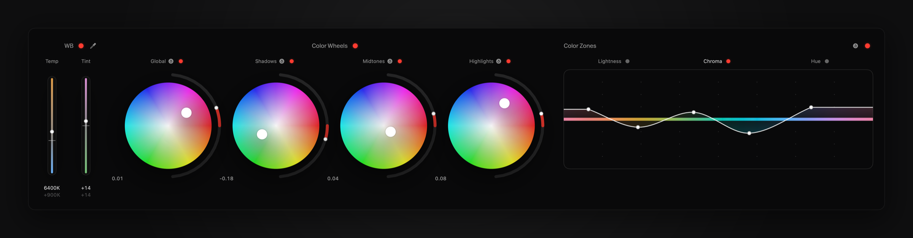
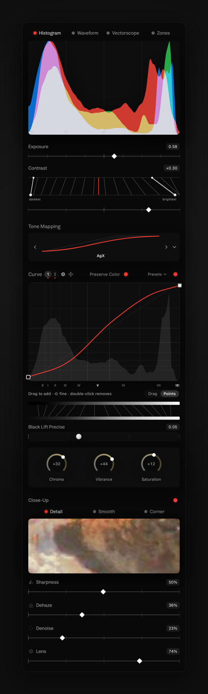
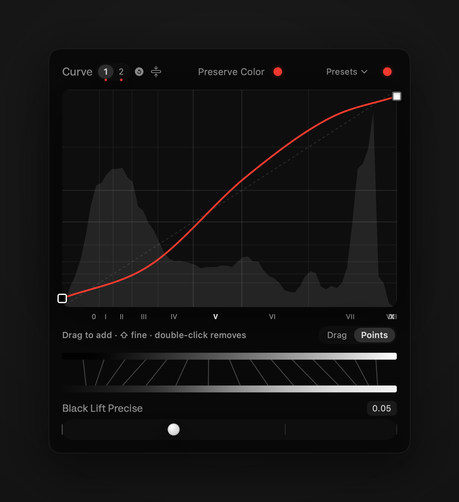
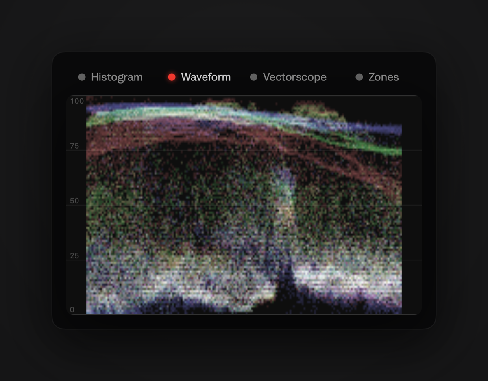
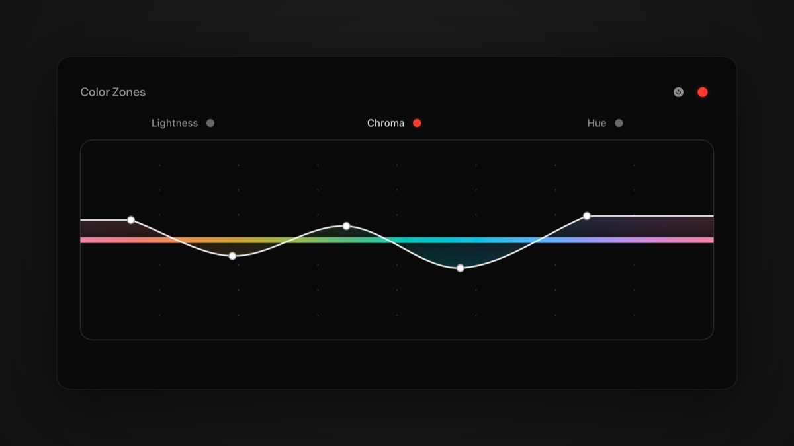

# Curves

A native macOS app for culling a shoot and editing RAW files, built for one photographer's
workflow. No accounts, no sync, no cloud: your photos stay in their folders, and edits live
alongside them.



<table>
  <tr>
    <td width="28%"></td>
    <td>
      
      
      
    </td>
  </tr>
</table>

## Features

### Culling

- Fast keyboard-driven grid: arrow keys to move, `0`–`5` to rate, `P` pick, `R` reject,
  `U` clear the flag, `Return` to open the editor
- Stacks for multiple exposures of the same frame (`G` to stack, `Shift-G` to unstack)
- Sessions (one per import) and Scenes (your own groups within a shoot)
- A filmstrip in the editor that mirrors the grid's filters and order
- Ratings, flags, and edits are written to sidecar files next to the originals

### Editing

- **Tone:** exposure, contrast, AgX and filmic tone mapping, and a points-based tone curve
  with a second stacked curve and presets
- **Color:** white balance with an eyedropper, three-way color balance wheels, Color Zones
  (hue, chroma, lightness), vibrance, and saturation
- **Looks:** 3D LUTs and film simulations from a folder-based LUT library
- **Detail and optics:** sharpening, dehaze, AI denoise (OpenImageDenoise), and lens
  correction for distortion, vignetting, and chromatic aberration
- **Retouching:** crop and straighten, spot removal, AI object removal, and gradient,
  color-range, and assisted masks
- **Workflow:** Stages (stackable edit layers you can save and reuse), presets, copy from
  recent edits, a version tree, and export presets (JPEG, PNG, TIFF)
- **Scopes:** histogram, waveform, vectorscope, and zones

## How it works

Curves runs its own image pipeline on Core Image. `CIRAWFilter` decodes and demosaics the
RAW file once (about 1.5 s for a 24 MP file); after that, each slider change re-renders in a
few milliseconds, because Core Image caches the decode and only recomputes what's
downstream. The same pipeline drives the live preview and the final export, so what you see
is what you get.

The project has three parts:

| Part | What it does |
| --- | --- |
| `Curves/Curves` | The SwiftUI app: grid, editor, controls, and export |
| `Curves/PhotoCatalog` | The SwiftData photo library: assets, sessions, scenes, and stages |
| `Curves/RawEngine` | Image processing: RAW decode, Core Image kernels, lens correction, denoise, and inpainting |

Several processing modules are ports of [darktable](https://github.com/darktable-org/darktable)'s
algorithms (filmic RGB, color balance RGB, AgX, color zones, RGB curve). darktable itself is
not a runtime dependency. [`PROJECT_BRIEF.md`](PROJECT_BRIEF.md) explains why.

## Building

**Requirements:** macOS 14 or later, Xcode, [XcodeGen](https://github.com/yonaskolb/XcodeGen),
and [Git LFS](https://git-lfs.com) (the object-removal model weights are stored in LFS).

```bash
brew install xcodegen git-lfs
git lfs install
git clone https://github.com/AustinGoodnight/curves.git
cd curves/Curves
xcodegen generate
open Curves.xcodeproj
```

Then build and run the **Curves** scheme. The Xcode project is generated from
`Curves/project.yml` and isn't checked in, so run `xcodegen generate` again after pulling
changes that add or remove files.

To build the packages on their own: `swift build` inside `Curves/RawEngine` or
`Curves/PhotoCatalog`.

## Developer notes

- **Developer Mode** (Settings) adds a component gallery and menus for comparing
  alternative control styles.
- **Marketing renders:** `Curves/Tools/export-marketing.sh` renders the screenshots and
  control animations (requires `ffmpeg`).

## Status

A personal project, under active development (v0.1). Expect things to change.

## License

Curves is licensed under the [GNU General Public License v3.0](LICENSE), because parts of
`RawEngine` are ported from darktable, which is GPL-3.0.

## Acknowledgements

- [darktable](https://github.com/darktable-org/darktable): the filmic RGB, color balance
  RGB, AgX, color zones, and RGB curve algorithms (GPL-3.0)
- [lensfun](https://github.com/lensfun/lensfun): the lens correction database, bundled
  unmodified (CC BY-SA 3.0), and its correction models
- [Intel Open Image Denoise](https://github.com/RenderKit/oidn): AI denoising (Apache 2.0)
- [LaMa](https://github.com/advimman/lama): the object-removal inpainting model (Apache 2.0)
- Scoutie Sans: the UI typeface (SIL Open Font License)
